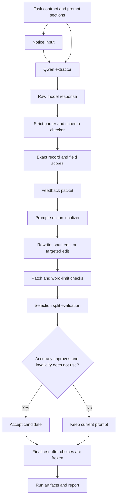

# PromptRepair: A Controlled Study of Prompt Repair for Structured Extraction

## Project report

**Course:** Prompt Engineering Laboratory  
**Course code:** [Confirm the course code with the department]  
**Submitted by:** [Student name]  
**Unique ID:** [Student ID]  
**Programme:** [Programme and department]  
**Project guide:** Dr. Srivani M, Assistant Professor  
**Institution:** Sri Ramachandra Faculty of Engineering and Technology, Sri Ramachandra Institute of Higher Education and Research, Porur, Chennai 600116  
**Academic year:** 2026–2027  
**Submission:** November 2026

## Bonafide certificate

I, **[Student name]**, bearing Unique ID **[Student ID]**, declare that this project report, titled **“PromptRepair: A Controlled Study of Prompt Repair for Structured Extraction,”** describes work carried out under the guidance of Dr. Srivani M for the Prompt Engineering Laboratory in the Department of **[Department]**, Sri Ramachandra Faculty of Engineering and Technology, during the academic year 2026–2027.

The report presents the completed controlled study and its notice-task prompt-repair prototype. It reports measured results and limitations from the project records. The separate cross-task data extension is identified as work in progress; no adapter training result is claimed.

**Student signature:** ____________________  
**Date:** ____________________

**Guide signature:** ____________________  
**Date:** ____________________

## Project presentation

Submitted for the Prompt Engineering Laboratory project presentation at Sri Ramachandra Faculty of Engineering and Technology on **[Presentation date]**.

| Internal examiner | External examiner |
| --- | --- |
| Name and signature: ____________________ | Name and signature: ____________________ |
| Date: ____________________ | Date: ____________________ |

## Table of contents

1. [Abstract](#abstract)
2. [Chapter 1 — Introduction](#chapter-1--introduction)
3. [Chapter 2 — Literature review](#chapter-2--literature-review)
4. [Chapter 3 — System architecture](#chapter-3--system-architecture)
5. [Chapter 4 — System implementation](#chapter-4--system-implementation)
6. [Chapter 5 — Results and discussion](#chapter-5--results-and-discussion)
7. [Chapter 6 — Conclusion and future work](#chapter-6--conclusion-and-future-work)
8. [References](#references)
9. [Appendix A — Example command and output contract](#appendix-a--example-command-and-output-contract)

## Abstract

Language models follow written instructions, and the wording of those instructions can change the answers they produce. This project studies how to correct a faulty prompt for a fixed information-extraction task. The system reads fictional college event notices and returns an event name, date, and venue in a strict machine-readable format. The main aim is to compare a focused prompt repair with a complete rewrite and to build a usable development prototype. The work defines a task contract, creates controlled prompt defects, evaluates model outputs, localizes likely prompt errors, proposes edits, and accepts a change only when a separate selection set improves. The primary dataset contains 60 notices divided into feedback, selection, and final-test groups. The selected open model is evaluated with exact-record accuracy, valid-format rates, field accuracy, and paired descriptive comparisons. On the retained setting, targeted repair and full rewrite each scored 35 correct records out of 40. A separate broader validation screen tested three synthetic prompt defects on 41 validation tasks: exact match fell from 39.0% on clean prompts to 0% for constant-output and wrong-format overrides and 4.3% for copy-input overrides. This verifies that the defects reduce task performance; it does not yet measure prompt repair or adapter performance.

**Keywords:** prompt repair, prompt optimization, information extraction, language models, evaluation, instruction following

# Chapter 1 — Introduction

## 1.1 Background of the study

Large language models can perform many tasks when a user describes the task in ordinary language. The prompt may specify the goal, the information to use, the response format, and rules for handling uncertain cases. For a structured extraction task, for example, the model may need to identify a named event, copy a date and venue exactly, and return a fixed set of fields. A prompt that leaves one of these requirements unclear can produce answers that look reasonable to a person but fail the program that consumes them.

Prompt quality is therefore part of system quality. A task can use the same model and the same input data but produce different results when the instruction changes. Common failures include extra commentary around a machine-readable answer, a missing key, a paraphrased value, a wrongly selected field boundary, or an unjustified choice between conflicting facts. These errors may come from an incomplete instruction, a vague rule, an output-format omission, or a conflict between prompt sections.

Prompt engineering is often done by trial and error. A developer changes a sentence, runs a few examples, and keeps the version that appears better. This method can be difficult to reproduce. It can also overfit to examples that were used while writing the prompt. A more careful process states the task contract, separates examples used for diagnosis from examples used to accept an edit, and reserves a final set for one evaluation after the prompt is fixed.

Automated prompt optimization treats the prompt as an object that can be proposed, scored, and revised. Prior work has generated candidate instructions, used textual feedback to revise prompts, or jointly optimized instructions and demonstrations [1–6]. PromptRepair studies a narrower decision inside this broader field: when a prompt has identifiable sections, does repairing the faulty section perform as well as rewriting the whole prompt? A controlled extraction task makes it possible to compare these strategies using exact, auditable outputs.

The core project focuses on fictional college event notices. Fictional notices provide a controlled setting in which dates, locations, titles, corrections, omissions, and conflicts can be designed without exposing private records. The output contract is narrow enough for exact scoring, while the examples include cases that require more than copying the nearest phrase. This makes the task useful for studying prompt repair, although it does not represent every real-world language task.

## 1.2 Problem statement and motivation

The project addresses the problem of a language model failing a fixed structured-extraction contract because the prompt is defective or insufficiently precise. In the study, the model must extract an event name, date, and venue from a notice. Each value must be copied according to the contract, unresolved values must be represented as null, and the response must contain exactly the required object and keys.

The practical problem is that a developer may respond to such failures by rewriting the entire prompt. A full rewrite can fix the observed error, but it can also change correct instructions, increase prompt length, or make it unclear which edit caused the improvement. A targeted repair may preserve sound sections, but it can fail if the error was localized to the wrong section or if sections interact. The project therefore compares full rewriting with focused edits under a shared evaluation process.

The study asks: **For the retained notice-extraction setting, can a targeted prompt repair reach the same strict accuracy as a full rewrite while changing less text?** The answer is measured on an untouched final-test split. The study does not claim that one method is universally better or that a notice-specific result transfers automatically to unrelated tasks.

## 1.3 Objectives of the study

The primary objective is to implement and evaluate a controlled prompt-repair workflow for structured extraction from fictional college notices.

The secondary objectives are:

- Define a fixed extraction contract and a strict output schema.
- Separate feedback, selection, and final-test examples to control prompt tuning.
- Inject controlled defects into individual prompt sections.
- Compare a full rewrite with targeted, span-based, and localized repairs.
- Record raw model outputs, exact scores, model settings, and run artifacts.
- Build a command-line prototype that accepts a notice-task prompt and produces a repair report using development examples only.
- Prepare a separate cross-task data extension without mixing it into the frozen primary study.

## 1.4 Significance of the study

The project provides a reproducible example of how to evaluate prompt changes rather than relying on a few hand-picked demonstrations. It shows how to write an explicit task contract, create development and final-test splits, score both content and response format, and preserve raw outputs. These practices are useful for coursework and for engineering teams that need to compare natural-language instructions in systems with automatic evaluators.

The study also separates two questions that are sometimes combined. The first is whether the model can follow the task contract. The second is whether a repair method can improve an already defective prompt. A model may perform well under a correct prompt while a repair method still fails to identify the right edit. Likewise, a repair method can fix a format issue without resolving semantic ambiguity in the labels. Keeping these questions distinct improves interpretation of results.

For students and researchers, the project offers a compact codebase with prompt rendering, localization, patch validation, inference, scoring, and report generation. The data are fictional and the results are bounded, so the project is best viewed as a controlled demonstration rather than a deployment-ready event system. The separate broader extension investigates task-disjoint data across multiple task types, but that extension does not yet establish general prompt-repair performance.

## 1.5 Organization of the report

Chapter 1 defines the problem and objectives. Chapter 2 reviews prompt generation, prompt optimization, instruction tuning, and task-generalization research. Chapter 3 explains the experiment pipeline and its modules. Chapter 4 describes the dataset, software, hardware, and implementation. Chapter 5 reports the final-test results, the separate prototype demonstration, and the broader data-preparation status. Chapter 6 summarizes the findings and gives practical next steps. The references list the research papers and dataset sources used in the report.

# Chapter 2 — Literature review

## 2.1 Related work

### Prompt generation and search

Automatic Prompt Engineer (APE) treats an instruction as a candidate program. A language model proposes alternatives, and a separate scoring process selects the most effective instruction for a task [1]. This work established a useful pattern: prompts can be generated and ranked by downstream performance. PromptRepair uses the same general idea of scored alternatives, but asks a different question. Rather than searching a broad pool of instructions alone, it compares a rewrite with smaller changes to a known multi-section prompt.

Prompt Optimization with Textual Gradients (ProTeGi) uses language feedback about failures to propose prompt revisions and explores alternatives with a beam-search procedure [2]. The method is relevant because it turns errors into explanatory feedback rather than relying only on a scalar score. PromptRepair similarly builds a feedback packet from observed failures and passing cases. The main difference is that PromptRepair constrains edits to defined sections or spans and applies an explicit selection rule before a candidate is accepted.

Optimization by PROmpting (OPRO) places previously scored candidates and their values into a meta-prompt, then asks a language model to generate new solutions [3]. OPRO illustrates how a model can use score history as optimization context. Its results also emphasize the role of the scoring function: an optimizer can only improve what the metric measures. PromptRepair therefore uses a strict record score for the structured task and preserves separate JSON and schema-validity measurements.

MIPRO optimizes instructions and few-shot demonstrations for multi-stage language-model programs [4]. It uses task-aware proposal generation and minibatch evaluation to guide the search. MIPRO is broader than the single-prompt comparison in this project, but it highlights two design needs: candidate generation should use task evidence, and evaluation should be budgeted. PromptRepair keeps its primary experiment smaller and holds the extractor model, dataset, and scoring rules fixed.

PromptWizard combines feedback-driven critique and synthesis to evolve prompts and examples across a collection of tasks [5]. It reports experiments across 45 tasks. GEPA uses natural-language reflection over execution traces to diagnose failures and evolve prompts, comparing prompt-space optimization with weight-space reinforcement learning [6]. These systems demonstrate that iterative prompt optimization can work across multiple tasks when an evaluator provides a useful signal. They do not remove the need for task-specific examples, metrics, or held-out evaluation.

### Prompt reliability and evaluation

Prompt wording and examples can influence model outputs. Mo et al. study malicious demonstrations and show that open models can follow inappropriate instruction cues [7]. This motivates controlled conflict cases, but it also warns against treating a synthetic prompt attack as representative of ordinary user mistakes. In the PromptRepair extension, constant-output and format overrides are deliberately marked as synthetic candidates; they must be re-screened and supplemented with more natural defects before they can support broad claims.

Prompt optimization results are not guaranteed to improve a baseline. A 2026 study across multiple methods and tasks reports that a substantial share of optimization runs performed below a zero-shot baseline, while some tasks showed clear gains [8]. This supports a headroom check and careful reporting of flat or harmful outcomes. In the primary study, the final scores show equality between targeted repair and rewriting in the retained setting; that equality is an important result, not evidence that all prompts are interchangeable.

### Instruction tuning and task diversity

Super-NaturalInstructions contains more than 1,600 natural language tasks and was designed to study generalization to tasks unseen during training [9]. Its task-level framing supports keeping all examples from a task together when measuring transfer. The FLAN Collection studies instruction-tuning data and finds that task balancing and prompt-format variety matter [10]. These findings motivate the cross-task extension’s task-disjoint splits and its effort to track categories and licenses. They also show why a large number of examples from only a few related tasks is not equivalent to broad task coverage.

### Parameter-efficient adaptation

LoRA freezes the original model weights and learns low-rank update matrices for selected layers [11]. QLoRA combines low-rank adapters with a quantized base model to reduce the memory required for fine-tuning [12]. These techniques make an adapter experiment possible on a single GPU, but they do not solve the data problem. Training examples must directly teach prompt repair, and the result must be tested on tasks that were not used to generate the repair targets.

### Dataset foundations

SQuAD 2.0 includes answerable and unanswerable questions, making it useful for testing whether systems abstain when the context does not support an answer [13]. AG News provides four news categories and is a common classification source; the project uses a small training-split sample and preserves its provenance [14]. Super-NaturalInstructions contributes a larger range of task definitions and examples [9]. Each source serves a different purpose, and the combined examples are not treated as repair trajectories by themselves.

### Comparison of related approaches

| Approach | Main operation | Evaluation signal | Relation to PromptRepair |
| --- | --- | --- | --- |
| APE [1] | Generate and rank candidate instructions | Task score | Supports score-based prompt selection |
| ProTeGi [2] | Use textual feedback to revise prompts | Task score and textual critique | Similar use of failures; PromptRepair constrains edit scope |
| OPRO [3] | Generate candidates from prior scored candidates | Candidate score history | Shows value of tracking proposal scores |
| MIPRO [4] | Optimize instructions and demonstrations | Minibatch task metric | Broader program optimization than the fixed-task study |
| PromptWizard [5] | Critique and synthesize prompt changes | Task feedback across tasks | Evidence that iterative optimization can cover diverse tasks |
| GEPA [6] | Reflect over execution traces and evolve prompts | Task metric plus trace analysis | A strong follow-on comparison for the broad extension |
| PromptRepair | Compare full rewrite and constrained local edits | Strict selection score | Tests whether smaller edits match a full rewrite |

## 2.2 Research gaps

Existing work demonstrates candidate generation, search, reflection, and instruction tuning. There is still a practical gap between those broad methods and the decision faced by a developer who already has a prompt divided into meaningful sections. A complete rewrite can improve scores but may alter correct parts. A local edit can preserve them but may fail when the diagnosis is wrong. The project isolates this trade-off in a fixed structured-extraction setting with a controlled final test.

A second gap is the separation between a successful prompt and a successful repair process. The oracle prompt provides a reference for task performance, but it does not show that a repair method can discover the oracle from the available evidence. This project keeps the oracle, original prompt, defective prompts, repair branches, and selection rule as distinct components.

A third gap concerns transfer. A repair method designed around a single extraction contract should not be called general merely because it can edit text. Different tasks require different metrics: classification may use accuracy or macro-F1; extraction may use exact span or field scoring; question answering may use exact match and token overlap; free-form writing often needs human review. The cross-task extension records source tasks and creates task-disjoint splits. Its fresh validation screen confirms degradation from the injected defects, but actual repair performance and transfer to held-out tasks remain unmeasured.

## Key challenges in existing systems

1. **Prompt changes can overfit.** Reusing the same examples to propose and select edits can reward memorization.
2. **The evaluator can be too narrow.** Exact match is clear for fixed labels but harsh for paraphrases and open-ended writing.
3. **Localization can be wrong.** A system may edit the wrong prompt section and reject a useful repair.
4. **A candidate can improve one metric and harm another.** Format validity, content accuracy, and abstention behavior should be reported separately.
5. **Task examples are not repair examples.** Input/output pairs teach a task; they do not by themselves teach how to repair a prompt.
6. **Task overlap creates false confidence.** Randomly splitting rows from one task can leak its style and label distribution into every split.

# Chapter 3 — System architecture

## 3.1 Proposed system and methodology

PromptRepair follows a staged workflow. First, the project defines a task contract and a structured prompt with four sections: instruction, context, constraints, and output format. The input notice is appended at runtime. This separation makes it possible to create a defect in one section while leaving the others unchanged.

Second, the system runs baseline prompts on development examples. The oracle prompt checks whether the task is solvable under the contract. Defective prompts are screened to determine whether their errors are meaningful and repairable. The final-test notices are held aside during this work. The primary dataset contains 10 feedback notices, 10 selection notices, and 40 final-test notices, with related examples grouped into 26 families.

Third, the repair process diagnoses observed failures. Rule-based localization uses known error patterns; behavioral localization compares output behavior; and LLM-based localization asks the model to infer which prompt section is implicated. An editor then proposes either a full rewrite, a span change, or an edit to one or more localized sections. The patcher checks whether a proposed change meets the allowed edit rules and word limits.

Fourth, a candidate is run on the selection split. It is accepted only when strict exact-record accuracy improves over the current prompt and schema-invalid responses do not increase. Ties preserve the earlier candidate. This rule makes the selection decision explicit and reduces the chance of accepting a longer prompt that merely sounds more precise.

Finally, after the selection decisions are fixed, the chosen arms are run on the final-test split. The report records accuracy, JSON validity, schema validity, field errors, paired descriptive comparisons, model configuration, and deviations from the planned environment. The broad cross-task extension uses separate files and splits; it is not allowed to alter the frozen notice-study scores.

## 3.2 System architecture diagram



The diagram shows the primary notice-task experiment. The separate cross-task extension begins with public task examples and synthetic prompt-defect candidates. It has its own manifests and splits and has not yet produced an evaluated repair model.

## 3.3 Module description

### Task contract and data loader

The contract defines the meaning of event, date, and venue, including when null is required and how to treat conflicting sources. The data loader reads the feedback, selection, and test files and checks family separation. Each record has an identifier, family, split, notice text, and reference fields. The final-test labels remain fixed even where a later review raised a possible punctuation-boundary ambiguity.

### Prompt renderer and defect injector

The prompt renderer combines four named prompt sections with the notice. The defect injector starts from the oracle prompt and introduces a controlled error into a selected section. This gives the experiment a known starting point and makes the arm definitions reproducible.

### Inference adapter

The local inference adapter loads Qwen2.5-14B-Instruct at a pinned model revision. It uses the tokenizer’s chat template, greedy decoding for the primary comparison, fixed batching, caching, and bounded retries. Raw outputs are retained without cleaning so that formatting failures remain visible.

### Evaluator

The evaluator parses strict JSON, rejects duplicate keys and nonstandard constants, checks that the top-level value is an object, verifies the exact key set, and checks value types. It then compares each field to the gold value using whitespace normalization only. It does not strip Markdown fences, silently convert strings to dates, or repair malformed output before scoring.

### Localizers and repair branches

The project includes rule-based, behavior-based, and LLM-based localization. The optimizer supports full rewrite and targeted section edits; the codebase also supports span-oriented edits. Candidate changes pass through a patch guard that enforces allowed operations and limits. Localization and editing are separated so that the report can show whether an error came from diagnosis or proposal quality.

### Selection, storage, and reporting

The selection stage evaluates candidates on the selection split and applies a fixed acceptance rule. The run system records prompts, raw responses, cache keys, model manifests, and metrics. Reporting scripts summarize arms and paired comparisons. The repository also contains a command-line Tier A prototype that repairs prompts for the fixed notice task and writes a Markdown and JSON report.

## 3.4 Algorithms and models used

The extraction model is a pretrained instruction model. The primary study does not fine-tune its weights. Greedy decoding makes repeated outputs deterministic for a fixed prompt and model configuration. The evaluator calculates strict accuracy as:

```text
strict accuracy = number of fully correct records / number of attempted records
```

A record is correct only when the response is valid JSON, follows the exact schema, and each field matches its reference. JSON-valid and schema-valid rates are also reported separately so that a formatting failure is not confused with a content error.

The repair acceptance rule is:

```text
accept candidate if:
    selection exact-record accuracy > current prompt accuracy
    and schema-invalid candidate responses <= current schema-invalid responses
otherwise:
    retain the current prompt
```

The study uses a family-clustered bootstrap for descriptive intervals and an exact family sign-flip analysis for paired comparisons. Because only one setting survived defect screening, these inferential values describe the retained sample and are not confirmatory evidence across multiple settings.

# Chapter 4 — System implementation

## 4.1 Hardware and software specifications

The primary runs were executed in a Molab GPU runtime on an NVIDIA RTX PRO 6000 Blackwell Server Edition. The runtime reported approximately 95 GiB of GPU memory, CUDA 13.0, driver 595.71.05, and PyTorch 2.11.0 with CUDA 13.0 support. The model used bfloat16 weights with no quantization for the primary study. The selected model was `Qwen/Qwen2.5-14B-Instruct`, revision `cf98f3b3bbb457ad9e2bb7baf9a0125b6b88caa8`.

The frozen plan specified Transformers 5.20.2. The final run manifest records Transformers 5.21.0. This version difference is recorded as a runtime deviation. The final-test generation took about 23.2 seconds for the D6 comparison under the recorded environment. The report does not interpret this time as a general speed guarantee because it depends on batching, prompt length, caching, and runtime load.

The broader data-preparation runtime used Python 3.13, PyTorch 2.11.0, Transformers 5.14.1, and the same GPU type. The active notebook Python initially could not import Accelerate; it was installed into the active runtime and Transformers’ cached availability check was cleared. This separate setup was used for data-screening inference. Parameter-efficient fine-tuning packages were not installed for the reported work, and no adapter training was performed.

## 4.2 Tools and libraries used

The project uses Python for data validation, scoring, run orchestration, and reporting. PyTorch and Transformers provide local model inference. Marimo provides the notebook interface used in the GPU runtime. JSON and JSON Lines store data and run outputs. Git stores code, task contracts, and analysis artifacts. The project’s Python modules cover the prompt renderer, evaluator, defect injector, localizers, optimizer, inference adapter, experiment runner, statistics, and reporting.

The broader extension uses `datasets` to prepare samples from AG News and SQuAD 2.0 and downloads selected Super-NaturalInstructions task records from the official training task list. It keeps source IDs, license labels, attribution fields, split manifests, and hashes. It also includes 720 project-generated extraction and structured-output examples. Raw public samples remain in the Molab runtime and are excluded from the restart ZIP; the repository stores manifests and counts rather than redistributing those samples.

## 4.3 Implementation details

The core implementation separates task definition from experiment control. The oracle prompt states the intended extraction behavior. The original prompt serves as a naturalistic comparison. Controlled defects are generated from the oracle so that the experiment can test how repair methods respond to specific mistakes. The same model serves as both extractor and editor, avoiding a second-model variable in the primary comparison.

Generation jobs are keyed by model, revision, prompt, notice, seed, and serving configuration. An append-only cache enables interrupted runs to resume without silently replacing earlier outputs. Batches are reduced after out-of-memory errors, with a bounded number of retries. Each result stores the raw response, parsed result, status, duration, and scores. This makes it possible to distinguish a model failure from a transport or runtime failure.

The evaluator treats the response as supplied. If the model wraps JSON in Markdown fences, the response is malformed for the strict contract. If the model selects a date where the gold requires null, the result is a null-policy violation. If it adds terminal punctuation to an event name that the gold omits, the field is marked incorrect. The scorer preserves these distinctions in the error analysis.

The optimizer has two main branches. The rewrite branch asks the editor to replace the prompt more broadly. The targeted branch uses a localizer to rank sections and asks for constrained edits. A candidate is checked for valid editor output, allowed section names, word limits, unchanged sections where required, and selection-set improvement. The candidate is not accepted merely because the editor gives a plausible explanation.

The command-line prototype applies this workflow to reviewer-supplied prompts for the same college-notice task. A user can provide a sectioned JSON prompt or plain text. The tool evaluates it on development feedback and selection cases, generates targeted and/or rewrite candidates, and emits before-and-after prompts, diffs, candidate decisions, and a Markdown report. It never loads the frozen final-test split. In the saved development demonstration, the faulty prompt scored 0/10 on selection; targeted edits were not accepted, while a full rewrite reached 9/10. This is a development demonstration on one task, not a cross-task result.

### Broad cross-task data extension

To explore a broader future version, the project prepared 25,881 task input/output examples across four sources. The current manifest records 17,952 training examples, 3,879 validation examples, and 4,050 held-out examples. The largest source is a cleaned Super-NaturalInstructions sample with 22,161 examples from 278 tasks. Its examples are split by task ID, and its structural audit found no duplicate IDs, task overlap across splits, missing attribution, or invalid expected-output records after removing 17 rows with no usable answer reference.

The remaining sources are 2,000 AG News examples, 1,000 SQuAD 2.0 examples, and 720 project-generated extraction and structured-output examples. These examples teach their source tasks; they are not prompt-repair trajectories. A fresh v3 candidate set has been created from the task-disjoint Super-NaturalInstructions split: 582 training prompt cases and 123 validation prompt cases, each with four feedback examples and eight selection examples. A validation screen has now measured the effect of three synthetic defects across 41 validation tasks. The older 60-task pilot split was superseded and is not mixed into the current split.

## 4.4 Dataset collection and description

### Primary notice study

The primary study uses 60 fictional college notices. Ten notices form the feedback set, ten form the selection set, and 40 form the handwritten final-test set. Notices are grouped into 26 families so related cases do not cross splits. The cases include complete notices, missing dates or venues, deadlines that distract from the event date, explicit corrections, unresolved conflicts, and event-title boundaries. Gold labels identify event, date, and venue; absent or unresolved values may be null according to the contract.

The feedback examples are used to show observed failures to the repair process. The selection examples determine whether a candidate is accepted. The final-test examples are used only after choices are fixed. The frozen test data are not used in the cross-task extension.

### Cross-task extension

The extension combines classification, question answering, information extraction, structured-output scaffolding, and other instruction tasks. AG News is sampled from its training split with 1,400 train, 300 validation, and 300 held-out examples. SQuAD 2.0 contributes 700 train, 150 validation, and 150 held-out examples, balanced between answerable and unanswerable questions and grouped by article title. Synthetic examples contribute 400 train, 160 validation, and 160 held-out records. The Super-NaturalInstructions sample uses only tasks in the official training task list and filters the task metadata to CC BY 4.0, MIT, and Apache 2.0 instance-license labels. It contains 15,452 train, 3,269 validation, and 3,440 held-out examples across 194, 41, and 43 tasks respectively.

| Source | Examples | Train | Validation | Held out | Role |
| --- | ---: | ---: | ---: | ---: | --- |
| AG News | 2,000 | 1,400 | 300 | 300 | Four-class news classification |
| SQuAD 2.0 | 1,000 | 700 | 150 | 150 | Answerable and unanswerable question answering |
| Project-generated examples | 720 | 400 | 160 | 160 | Extraction and structured-output scaffolding |
| Super-NaturalInstructions | 22,161 | 15,452 | 3,269 | 3,440 | Task-disjoint instruction examples |
| **Total** | **25,881** | **17,952** | **3,879** | **4,050** | Input/output examples, not repair pairs |

The primary study and this extension have different purposes. The primary dataset has frozen labels and reported final-test results. The extension is a development resource for constructing a later multi-task repair benchmark. Its source examples and synthetic prompt cases are not evidence that a general repair model has been trained.

## 4.5 Code snippets and pseudocode

The required output contract for the core extractor is represented as:

```json
{
  "event": "event name",
  "date": "date as written or null",
  "venue": "venue as written or null"
}
```

The central experiment can be summarized as:

```text
load frozen task contract and development splits
load the pinned extractor/editor model
score each baseline prompt on feedback and selection examples
screen controlled defects using the predefined rules
for each eligible defect:
    build a feedback packet from permitted development examples
    localize the likely faulty prompt section
    propose a full rewrite and/or a constrained local repair
    score each candidate on the selection split
    accept only if strict accuracy improves without added invalid outputs
freeze all selected prompts
run each retained arm once on the final-test set
save raw responses, hashes, metrics, deviations, and analysis
```

The cross-task extension follows a separate process:

```text
collect licensed task examples from training sources
keep every source task within exactly one split
create synthetic prompt-defect candidates only for train and validation
measure clean and corrupted prompts with task-appropriate metrics
keep held-out tasks sealed until the method and checkpoint are fixed
```

# Chapter 5 — Results and discussion

## 5.1 Experimental results

Only D6 survived the primary defect-screening procedure. The final test contains 40 notices from 14 families. The retained primary comparison found no aggregate difference between a targeted repair and a complete rewrite: both scored 35/40, or 87.5%, with valid JSON and valid schema on all 40 responses. The result answers the study question for this setting: targeted repair matched the rewrite’s observed strict accuracy, but did not outperform it.

| Arm | Strict accuracy | JSON valid | Schema valid |
| --- | ---: | ---: | ---: |
| Defective prompt | 0/40 (0.0%) | 40/40 | 0/40 |
| Full rewrite | 35/40 (87.5%) | 40/40 | 40/40 |
| Span repair | 35/40 (87.5%) | 40/40 | 40/40 |
| Rule-based localization | 35/40 (87.5%) | 40/40 | 40/40 |
| LLM-based localization | 35/40 (87.5%) | 40/40 | 40/40 |
| Behavioral localization | 35/40 (87.5%) | 40/40 | 40/40 |
| Oracle section | 35/40 (87.5%) | 40/40 | 40/40 |
| Oracle prompt | 35/40 (87.5%) | 40/40 | 40/40 |
| Random instruction section | 0/40 (0.0%) | 40/40 | 0/40 |
| Random context section | 11/40 (27.5%) | 40/40 | 11/40 |
| Random constraints section | 0/40 (0.0%) | 40/40 | 0/40 |
| Random output-format section | 35/40 (87.5%) | 40/40 | 40/40 |
| Naturalistic original prompt | 0/40 (0.0%) | 2/40 | 2/40 |
| Restricted baseline | 35/40 (87.5%) | 40/40 | 40/40 |

The defective prompt produced syntactically valid JSON but failed the schema on every record. This shows why JSON validity alone is not enough. The original naturalistic prompt also scored 0/40 strict accuracy. Its development gate had 20/20 strict failures, all caused by Markdown fences around JSON. On the final test, 38 responses were fenced and two additional responses violated the null policy.

The restricted baseline scored 18/20 on development and 35/40 on the final test, with valid JSON and schema in every final-test response. Its final run occurred after other final-test outcomes had been observed, although the prompt was not changed. This order is recorded as a limitation in the final interpretation.

## 5.2 Performance comparison and benchmarks

For the primary paired comparison, LLM-based localization minus full rewrite had an observed difference of 0.0 percentage points. The family-bootstrap interval was [0.0, 0.0], and both the bootstrap and exact family sign-flip tests returned p = 1.0000. This reflects the tied scores in the retained setting. It does not show that the methods will tie on other tasks or settings.

The oracle-section arm exceeded the mean of the random-section arms by 58.8 percentage points in the retained setting. Its 95% family-bootstrap interval was [46.5, 69.9], with bootstrap p < 0.0001 and exact family sign-flip p = 0.0002. This is a within-setting descriptive comparison. The preregistered across-setting confirmatory tests and Holm correction were not run because only one setting survived screening.

The selected prompt families also show that prompt components do not contribute equally in every controlled defect. Replacing the instruction or constraints with random content reduced performance sharply. Replacing the output-format section with a random section happened to retain 35/40 in this particular run. These arm results should not be read as a general ranking of prompt sections; only one setting remained after screening, and no independent reruns were available.

### Separate command-line prototype demonstration

The reviewer-prompt prototype was also demonstrated on a separate development-only case. The input prompt scored 0/10 exact records on the selection examples. The targeted method considered two sections but accepted neither candidate. The rewrite method changed four sections and reached 9/10 exact records on the selection split without increasing invalid responses. The report saved the prompts, diffs, rejected-candidate details, and scores. The frozen final-test split was not loaded. This result demonstrates the end-to-end workflow for the fixed notice task; it is not a benchmark of general-purpose prompt repair.

### Cross-task synthetic-defect validation screen

The fresh v3 validation screen evaluated the pinned Qwen2.5-14B-Instruct model on 328 input/output examples drawn from 41 validation tasks. The clean prompt reached 128/328 exact matches (39.0%) and a mean token F1 of 0.557. Each synthetic defect was evaluated on the same 328 examples. Results were:

| Prompt condition | Exact match | Mean token F1 | Change in exact match vs. clean | Tasks worse / equal / better |
| --- | ---: | ---: | ---: | ---: |
| Clean prompt | 128/328 (39.0%) | 0.557 | — | — |
| Constant-output override | 0/328 (0.0%) | 0.000 | −39.0 percentage points | 25 / 16 / 0 |
| Copy-input override | 14/328 (4.3%) | 0.187 | −34.8 percentage points | 23 / 17 / 1 |
| Wrong-JSON-format override | 0/328 (0.0%) | 0.457 | −39.0 percentage points | 25 / 16 / 0 |

All three injected defects reduced aggregate exact match. The wrong-format condition retained a relatively high token F1 while achieving zero exact matches, illustrating that lexical overlap does not guarantee a correct structured response. Effects varied by task: for example, copy-input exact match was 0/48 on classification, 0/56 on information extraction, 3/104 on question answering, and 11/80 on other instruction tasks. Counts and rates are descriptive for this validation screen and this model. Because the defects are synthetic and deliberately disruptive, these results establish that the candidate prompts degrade performance; they do not show that an optimizer can diagnose or repair them. No held-out task results are included here. The Molab output artifact is `repair_candidate_v3_validation_screen.json`.

## 5.3 Visualization of results

The main results can be shown as a compact accuracy chart:

```text
Final-test strict accuracy

Defective prompt         0.0%  |
Original prompt          0.0%  |
Random instruction       0.0%  |
Random constraints       0.0%  |
Random context          27.5%  |██████████████
Rewrite                 87.5%  |████████████████████████████████████████████
Targeted repair         87.5%  |████████████████████████████████████████████
Restricted baseline     87.5%  |████████████████████████████████████████████
```

The table and chart summarize the same 40-notice final-test outcomes. The bars do not show uncertainty across independent model runs, because the experiment used one model and one retained setting. The category results below show where the remaining errors occurred.

| Error group | Rewrite / oracle / restricted baseline | Interpretation |
| --- | ---: | --- |
| Venue absent or pending | 8/8 | All three arms followed the null or pending-venue rule |
| Date absent | 6/6 | All three arms returned the required value |
| Deadline distractor | 6/6 | All three arms selected the event date |
| Explicit correction | 6/6 | All three arms followed the stated correction |
| Unresolved conflict | 4/6 | Two cases incorrectly selected a date instead of null |
| Complete unambiguous notices | 5/8 | Three event-name boundary errors remained |

## 5.4 Interpretation and analysis

The central result is a tie in aggregate accuracy. Targeted repair reached the same 35/40 score as full rewriting, while making a narrower intervention by design. This supports targeted repair as a viable option for the studied structured task, but the experiment did not show a strict accuracy advantage. A practical choice between the two would also consider edit size, clarity, maintainability, and the risk of changing correct prompt sections. Those outcomes were not established by the accuracy table alone.

The five remaining errors were concentrated in two patterns. Three complete-event cases involved terminal punctuation. The notice text placed an exclamation mark directly after the event title, while the frozen gold omitted it. Under a strict verbatim-copy metric, the model’s punctuation becomes an event mismatch. This may be a boundary ambiguity in the annotation rule. The frozen labels and scores were retained; the report does not revise them after seeing final-test results.

The other two failures were unresolved date conflicts. The task contract required null when neither date had priority, but the models chose one of the dates. One arm also reformatted a date in one such case. These are meaningful errors because the prompt needs to distinguish a stated correction from two unresolved alternatives. The models’ performance on explicit corrections was perfect in this sample, while unresolved conflicts remained harder.

The original prompt’s failure was primarily a formatting failure rather than an inability to identify all fields. Its outputs were often wrapped in Markdown fences, which violated the exact output contract. This explains why syntactic content can appear correct to a person while failing an automated consumer. The restricted baseline and rewritten prompts removed that problem, but they shared the five remaining semantic errors.

The statistical results must be interpreted within the design. Only one setting survived screening, so cross-setting confirmatory analyses were unavailable. Paired tests and bootstrap intervals are descriptive for the retained set. The final set contains 40 notices but only 14 families; notices within one family are related and should not be treated as fully independent. The small, fictional dataset also limits external validity.

The command-line demonstration showed that a full rewrite could improve a poor development prompt from 0/10 to 9/10 selection exact accuracy when the targeted edits did not pass the acceptance rule. This is useful as an implementation demonstration, but the sample is small and task-specific. The tool should be described as a notice-task prototype, not as an application that repairs arbitrary prompts.

The cross-task data extension is a separate contribution in preparation. It contains 25,881 structurally audited task examples and fresh synthetic repair candidates. The current validation screen confirms that the three injected defect types reduce exact-match performance on 41 validation tasks. Earlier pilot results came from a superseded task split and are not used as final evidence. The screen does not measure whether a repair system can identify the defect or recover the clean-prompt score. No adapter was trained, and no multi-task repair result is reported. The extension therefore supports future experimentation but does not change the primary study’s conclusion.

The results are consistent with a broader lesson from prompt optimization research: optimization needs a useful metric, a measurable baseline, and a genuinely separate validation set. A longer prompt or a convincing explanation from an editor does not establish an improvement. A prompt repair should be accepted only after it improves the task score under a fixed evaluation process and does not create unacceptable regressions.

# Chapter 6 — Conclusion and future work

## 6.1 Conclusion

This project implemented and evaluated a controlled prompt-repair workflow for structured information extraction from fictional college event notices. The system uses a fixed task contract, a four-section prompt, controlled defects, a strict JSON evaluator, three localization methods, constrained editing branches, a development selection rule, and a frozen final-test evaluation. It also includes a command-line prototype that demonstrates prompt input, candidate generation, acceptance, diffs, and a saved report for the same notice task.

In the retained experimental setting, targeted repair and full rewriting both achieved 35/40 strict accuracy, or 87.5%, and both produced valid JSON and schema on all final-test notices. Targeted repair matched the rewrite but did not exceed it. The oracle and restricted baseline also scored 35/40. The defective and original prompts scored 0/40. Remaining errors concerned event-title punctuation and unresolved date conflicts. The results therefore show that prompt structure and output rules mattered in this task, while also showing that clearer instructions did not eliminate every boundary and conflict error.

The project’s completed scope is the notice-task study and its development prototype. The study used one model, a small fictional dataset, one retained setting, and one final-test run. Its scores are descriptive for this experiment and should not be generalized to arbitrary prompts, data, or models. The report preserves the frozen labels and records the run-order and software-version deviations.

A separate cross-task extension has prepared a larger, task-disjoint collection of source examples and synthetic repair candidates. Its validation screen shows that three controlled defects reduce exact-match performance on the validation tasks. It has not yet evaluated repair behavior, trained an adapter, or measured transfer to held-out tasks. The extension is recorded as a next phase rather than presented as a completed model result. This distinction leaves the completed findings clear while preserving a practical path toward broader prompt repair.

## 6.2 Future work

The next step is to run the same clean-versus-defect screen on the training candidates and check a sample of cases for quality. Then the project can build repair examples and evaluate a repair method on validation tasks, keeping feedback examples for diagnosis and selection examples for acceptance. The current validation screen establishes degradation from synthetic defects, not repair success. Evaluation should use task-appropriate metrics: exact match and token overlap can help with short answers, while classification should also report accuracy or macro-F1 and long-form generation or rewriting needs stronger semantic checks and human review.

The candidate defects should also be made more realistic. Constant-answer, copy-input, and wrong-format overrides are controlled stress tests. They are useful for checking that the pipeline detects obvious contradictions, but they are easier than the incomplete, ambiguous, or internally inconsistent prompts reviewers may actually provide. New candidates should include omitted requirements, conflicting rules, unclear field boundaries, missing abstention rules, and format mistakes. A candidate should enter the repair-training set only after measured degradation on feedback and selection examples.

The broad repair benchmark should keep task IDs disjoint across training, validation, and held-out sets. The held-out tasks should remain sealed until repair methods, metrics, and checkpoints are fixed. A sampled set of generated repairs should receive human review. Attribution and license obligations should be retained with each task, especially for sources that require attribution.

Only after a sufficiently varied, validated repair dataset is ready should the team begin the planned quantized low-rank adapter experiment. The run should use resumable checkpoints, a persistent output location, a short throughput pilot, a fixed training budget, and validation-based checkpoint selection. The final comparison should measure base-model and adapter repair performance on held-out tasks, report per-family scores, and include model, data, and run hashes. An 8–10-hour GPU window is a resource target, not a guaranteed completion time; throughput must be measured before the run.

For the notice-task prototype, future work can add a clearer interface, better display of field-level errors, downloadable repair reports, and direct user-provided examples. Those changes should continue to use development data only. A broader application should require a prompt, input/output examples, an evaluator or scoring rule, and enough examples to separate repair feedback from candidate selection. A prompt by itself does not provide enough evidence to know which change will improve its results.

# References

1. Zhou, Y., Muresanu, A. I., Han, Z., Paster, K., Pitis, S., Chan, H., and Ba, J. (2023). [Large Language Models Are Human-Level Prompt Engineers](https://openreview.net/forum?id=92gvk82DE-). International Conference on Learning Representations.
2. Pryzant, R., Iter, D., Li, J., Lee, Y. T., Zhu, C., and Zeng, M. (2023). [Automatic Prompt Optimization with “Gradient Descent” and Beam Search](https://aclanthology.org/2023.emnlp-main.494/). Proceedings of EMNLP.
3. Yang, C., Wang, X., Lu, Y., Liu, H., Le, Q. V., Zhou, D., and Chen, X. (2024). [Large Language Models as Optimizers](https://proceedings.iclr.cc/paper_files/paper/2024/hash/3339f19c5fcee3ad74502947a32be9e6-Abstract-Conference.html). International Conference on Learning Representations.
4. Opsahl-Ong, K., Ryan, M. J., Purtell, J., Broman, D., Potts, C., Zaharia, M., and Khattab, O. (2024). [Optimizing Instructions and Demonstrations for Multi-Stage Language Model Programs](https://aclanthology.org/2024.emnlp-main.525/). Proceedings of EMNLP.
5. Agarwal, E., Magazine, R., Singh, J., Dani, V., Ganu, T., and Nambi, A. (2025). [PromptWizard: Optimizing Prompts via Task-Aware, Feedback-Driven Self-Evolution](https://aclanthology.org/2025.findings-acl.1025/). Findings of ACL.
6. Agrawal, L. A., Tan, S., Soylu, D., Ziems, N., Khare, R., et al. (2025). [GEPA: Reflective Prompt Evolution Can Outperform Reinforcement Learning](https://arxiv.org/abs/2507.19457). arXiv preprint.
7. Mo, L., Wang, B., Chen, M., and Sun, H. (2024). [How Trustworthy are Open-Source LLMs? An Assessment under Malicious Demonstrations Shows their Vulnerabilities](https://aclanthology.org/2024.naacl-long.152/). Proceedings of NAACL-HLT.
8. Zhang, X., Wang, G., Cui, Y., Qiu, W., Li, Z., Zhu, B., and He, P. (2026). [Prompt Optimization Is a Coin Flip: Diagnosing When It Helps in Compound AI Systems](https://arxiv.org/abs/2604.14585). arXiv preprint.
9. Wang, Y., Mishra, S., Alipoormolabashi, P., Kordi, Y., Mirzaei, A., et al. (2022). [Super-NaturalInstructions: Generalization via Declarative Instructions on 1600+ NLP Tasks](https://aclanthology.org/2022.emnlp-main.340/). Proceedings of EMNLP.
10. Longpre, S., Hou, L., Vu, T., Webson, A., Chung, H. W., Tay, Y., Zhou, D., Le, Q. V., Zoph, B., Wei, J., and Roberts, A. (2023). [The FLAN Collection: Designing Data and Methods for Effective Instruction Tuning](https://proceedings.mlr.press/v202/longpre23a.html). Proceedings of ICML, PMLR 202.
11. Hu, E. J., Shen, Y., Wallis, P., Allen-Zhu, Z., Li, Y., Wang, S., Wang, L., and Chen, W. (2022). [LoRA: Low-Rank Adaptation of Large Language Models](https://openreview.net/forum?id=nZeVKeeFYf9). International Conference on Learning Representations.
12. Dettmers, T., Pagnoni, A., Holtzman, A., and Zettlemoyer, L. (2023). [QLoRA: Efficient Finetuning of Quantized LLMs](https://proceedings.neurips.cc/paper_files/paper/2023/hash/1feb87871436031bdc0f2beaa62a049b-Abstract.html). Advances in Neural Information Processing Systems 36.
13. Rajpurkar, P., Jia, R., and Liang, P. (2018). [Know What You Don’t Know: Unanswerable Questions for SQuAD](https://arxiv.org/abs/1806.03822). Proceedings of ACL.
14. Hugging Face Datasets. [AG News dataset card](https://huggingface.co/datasets/fancyzhx/ag_news). Accessed 30 October 2026.
15. Qwen Team. [Qwen2.5-14B-Instruct model card](https://huggingface.co/Qwen/Qwen2.5-14B-Instruct). Accessed 30 October 2026.

# Appendix A — Example command and output contract

The Tier A command-line prototype can be run with a prompt file and a mode. For example:

```powershell
python scripts/repair_prompt.py `
  examples/reviewer_prompts/demo_missing_venue_key.json `
  --mode both `
  --run-id demo-missing-venue
```

The supported modes are `targeted`, `rewrite`, and `both`. The output directory contains before-and-after prompt files, a unified diff, rejected-candidate details, cached generations, and a Markdown and JSON report. The tool uses development feedback and selection splits only.

The extractor’s strict contract is:

```json
{"event":"string","date":"string or null","venue":"string or null"}
```

The final answer must contain exactly one object with exactly these keys. It must not include Markdown fences, commentary, extra keys, or values not supported by the notice. Dates and venue text are copied according to the task contract, and unresolved conflicts are represented as null.
